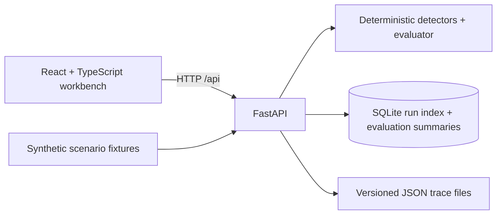

# TraceScope

TraceScope is a local-first trace replay and evaluation workbench. It helps inspect what an agent did, find likely loops and failures, replay recorded behavior without a model, and compare runs.

## Start locally

Requirements: Python 3.9+ and Node.js 20+. Every project dependency is free and open source. The app makes no model calls and does not connect to external MCP servers. After cloning, start both services with one command:

```sh
./start.sh
```

The script creates a local Python virtual environment, installs missing dependencies, and starts the API and frontend. It reuses a running TraceScope API or picks the next free port if port 8000 is occupied. Open [http://localhost:5173](http://localhost:5173). Press `Ctrl+C` to stop the services started by the script. Dependency installation needs internet access the first time.

For manual startup instead:

```sh
python -m venv .venv
source .venv/bin/activate
pip install -r backend/requirements.txt
uvicorn backend.app.main:app --reload --port 8000
```

In another terminal:

```sh
npm install
npm run dev
```

Open [http://localhost:5173](http://localhost:5173). Vite proxies `/api` to the local FastAPI service. The API seeds four synthetic scenarios and a corrected loop run on its first start. SQLite metadata and JSON run records live in `data/`.

### Docker

Docker and Docker Compose are free tools. From this directory:

```sh
docker compose up --build
```

Then open [http://localhost:8000](http://localhost:8000). Compose stores data in a named local volume. Stop with `Ctrl+C`; remove the container and stored demo data with `docker compose down -v`.

## What you can do

- Search and filter run history, then inspect a chronological timeline with expandable sanitized arguments, result summaries, and error details.
- Review heuristic alerts for repeated identical calls, retry counts, tool errors/timeouts, slow calls, and high step counts. Thresholds are visible and configurable where exposed in the UI.
- Replay a saved run by copying its recorded trace into a new run. Replay never invokes an agent, model, or tool.
- Run built-in synthetic scenarios using deterministic fake tools: search, calculator, tool error, and slow call.
- Compare two traces for added/removed calls, order, duration, step count, token count, outcome, and new errors.
- Run the four-case evaluation suite and inspect scenario checks and aggregate scores with their method and denominator.
- Import a version 1.0 trace as JSON, copy the current trace, or download it.

## Trace format

The independent JSON trace contract is versioned with `schema_version`. The formal contract is [`schema/trace-v1.schema.json`](schema/trace-v1.schema.json); example files are in [`examples/`](examples/). The API validates the version and event essentials and scrubs credential fields and common bearer/API-key patterns before persisting imports. Trace content should still be reviewed before sharing: a detector cannot reliably identify every private value in free-form text.

| Field | Meaning |
| --- | --- |
| `schema_version` | Trace contract version (`1.0`) |
| `run_id`, `scenario`, `started_at` | Run identity and scenario metadata |
| `agent_config` | Safe configuration label and execution mode; never include credentials |
| `events[]` | Ordered event records with `id`, optional `parent_id`, `type`, timestamp, duration, status, title, and optional tool/arguments/result/error/token metadata |
| `outcome`, `review_notes` | Final result and optional human review |
| `metadata` | Synthetic marker, duration, token count, and optional replay lineage |

Supported event types are `model_request`, `model_response`, `tool_call`, `tool_result`, and `tool_error`. Event types remain extensible. Credentials belong in neither arguments nor titles; import redaction removes known credential fields and recognizable key strings. Example traces are wholly synthetic.

## Evaluation method

Each evaluation creates a fresh run for four fixed scenarios. Checks cover expected outcome, allowed tool names, repeated call signatures, and a five-call maximum. Scores report the scenario count and method with the result: pass rate, mean tool-selection accuracy, failure rate, loop rate, median elapsed time, and total reported tokens. These are transparent deterministic checks, not a model quality benchmark. Token use is synthetic metadata. The baseline profile intentionally repeats a call five times, while the corrected profile makes one call; run both profiles to compare their evaluation results.

## Heuristic limits

Repeated calls and high step counts are evidence for review, not proof of a defect. Retries may be reasonable, latency can vary, and sequence alignment is intentionally simple. This MVP does not execute arbitrary code, run a live agent, or connect to real MCP servers. The fake tools are represented as deterministic recorded traces; model metadata is synthetic. SQLite stores run indexes and evaluation summaries; complete traces are versioned JSON files.

## Architecture



All runtime dependencies are free/open-source: React, TypeScript, Vite, FastAPI, Pydantic, Uvicorn, and SQLite. There are no paid accounts, API keys, font CDNs, analytics, or external service dependencies.
